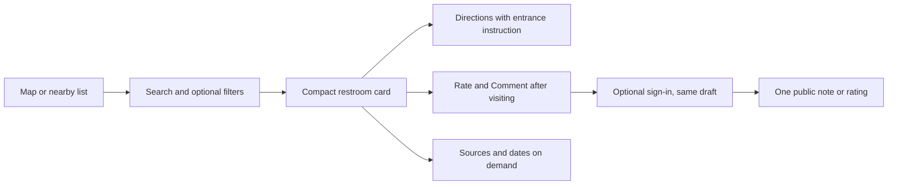

# Restroom Ready usability audit — November 5, 2026

The basic discovery workflow is operable. The most useful next changes concern information priority, recovery after failed actions, and consistency between the iPhone app and website. Keep the map-first layout, inline search, resizable place card, and grouped Rate and Comment destination.

This is an expert workflow/source review with actual browser and simulator checks, not a study with new customers. The persona passes are explicitly simulations. Recommendations have not been implemented.

## What was audited

- **25 native workflow groups:** discovery, search, filters, location, sheets, hours, amenities, conditions, directions, account, Saved, comment history, sign-in, rating, unified notes, new restrooms, codes, sources, privacy/deletion, summary availability and recovery.
- **37 web/shared function groups:** the finder, account/contribution boundaries, data and error handling, public demo, marketing routes, signup/email infrastructure, privacy, Analytics and account deletion.
- **20 browser checks:** signed-out production reading/navigation and safe memory-only demo interactions, including mobile layouts at 390/320 pixels and desktop at 1440 pixels.

The live web bundle remained `20261105T064821Z-378edaa8fc9f`, SHA-256 `6138803466239466c8bf90bfe7eaa4205959568c858ea7d2b18000950d037aac`. Native checks used the latest frozen source on an isolated iPhone 17 Pro simulator, not an installed TestFlight binary.

## Changes to prioritize

| Priority | Finding | Concrete recommendation | Evidence |
| --- | --- | --- | --- |
| First | Known entrance instructions and restrictions are under Sources & dates on iPhone. | Put a short known restriction and entrance/inside-route instruction on the decision card before Directions. Keep source evidence in Sources & dates. | Journey review; native `PlaceDetailSheet.swift:243` |
| First | The closing time is clipped at the largest accessibility text size when the Hours value starts with “Venue hours.” | Let the complete Today value wrap at accessibility sizes; put its scope qualifier on a separate supporting line if needed. Preserve the full week and venue/restroom distinction. | Native N8; [actual screenshot](screenshots/native-amenities-large.png) |
| First | A contribution error says “Refresh your account,” but Account has no such action. | Give a visible retry/reauthentication action that preserves the exact draft, or describe the actual sign-in-again steps. Use customer language for provider errors. | Native N1/N5 |
| First | Important web behavior differs from the app. | Support combined filters and consistent accessibility discovery. Converge on one Add a public note form and owner-management path. Preserve legacy records and source boundaries. | Web W05–W07; browser R04 |
| Next | “Listed Operational” can appear as the native Condition answer. | Keep condition observations separate from a dated operating status. A known closure should be conspicuous; an operating listing is not a cleanliness/supplies report. | Journey review; `CardResearchProfile.swift:76` |
| Next | An uncertain new-restroom retry can reuse its ID with an edited payload. A pending native code report also uses an ordinary discard warning. | Pin the exact attempted payload until its outcome is resolved. Make pending-save cancellation truthful; offer a deliberate new draft separately. | Web W01; native N2 |
| Next | A vertical drag changes the web star draft. | Preserve half-star taps/horizontal sliding while allowing vertical scrolling. Native already distinguishes gesture intent; keep that behavior. | Web W02; [reproduced in safe demo](screenshots/demo-vertical-star-drag-390.png) |
| Next | A newly posted report about an older visit can be absent from the web's latest-ten feed. | Order the bounded feed by posting time, while displaying the actual visit time separately. | Web W03 |
| Next | Long native code history places Report a new code below the reports. Large-text interaction remains unresolved. | Keep the preferred code and primary report action easy to reach; disclose alternative history separately without changing consensus or ownership rules. | Native N9 and runtime evidence |
| Next | New-code and new-restroom forms silently disable submission for some invalid codes. | Show a concise inline reason/limit. Also state clearly that the note's visit time is public and that a code has its own visibility setting. | Native N6/N7 |
| Next | Native filter-empty behavior no longer matches the earlier request for a system alert. | Keep typed-search empty results inline. Restore a filter-specific alert/recovery path if following that request, with a direct Clear filters action. | Native N10; current runtime shows inline feedback for both |
| Next | The website's main CTA and demo teach an earlier product stage. | Make the real finder the primary destination. Update or retire demo-only private-note/code-editing flows; retain the clearly labeled sample-data boundary. Keep an updates signup only if it still serves a purpose. | Web W08/W09; browser R01/R17 |

Additional findings in the detailed reports cover coincident map pins, duplicate rating-loading controls, returning to a Save after login, missing web Apple/account/history/deletion parity, stale form names in privacy copy, and cold-offline recovery that still needs runtime confirmation.

## A clearer user workflow

For the Fifth Avenue wheelchair scenario, the initial card should expose the reported right-side entrance and elevator instruction before the user leaves for Maps. A generic Accessible amenity is not the entire route. Address pins remain venue points, and external walking directions do not certify a wheelchair-suitable street route.

The first decision surface should answer: which place, what entry restriction is known, how to get inside, today's hours, what was reported about condition, and which code is currently preferred. Show the rating average/count next to the name. Put contribution editors and extended evidence behind their existing deliberate destinations. Keep unfavorable facts and critical unknowns visible; avoid repeating long technical caveats in every section.

## Verification results and limits

| Check | Result |
| --- | --- |
| Web tests | 319 passed |
| TypeScript | Passed |
| Current Firestore rules/SDK tests | 696 passed, 11 suites, disposable local emulator |
| Account-deletion unit/deployment-policy tests | 26 passed |
| Native model tests | 170 passed |
| Native simulator UI | 16 of 20 checks passed; four failed checks remain documented |

Two native paths that failed under older scrolling assumptions passed in the explicit-expanded follow-up at normal and largest text. Both failed long-code-history checks remain unresolved. One follow-up pan opened the sign-in sheet before the intended action; this does not prove permanent unreachability, and the report does not claim every UI test passed. The large-text Hours truncation is independently visible in a current screenshot even though other checks passed.

Every listed function was reviewed, but real Apple/Google credential exchange, signed-in private account history, production contributions/deletion, physical GPS/touch, VoiceOver, actual Analytics receipt/email delivery and eligible-device Apple Intelligence output are not fully verified by these checks. Protected data transitions were exercised with emulator/model fixtures. The native note form also used its existing nonpublishing DEBUG review mode.

All 85 audited web source hashes and 129 frozen native inputs remain unchanged/restored. Temporary browser sizing was reset, the audit tab closed, isolated simulator/emulator stopped, and the task-only Java runtime removed. No release or production contribution was made by this audit.

## What to validate with people next

Use a test copy with fixtures and ask people to complete tasks without navigation hints:

1. Near Fifth Avenue, find a restroom and explain which entrance and inside route they would use. Include a person with relevant mobility/access needs.
2. Find a place matching both Clean and Accessible, then explain the evidence and dates.
3. Save while signed out, sign in, find it again and return to the map.
4. Add one public observation without being required to rate; explain whether their name, visit time and optional code will be public.
5. Recover from a failed save or incorrect code, then explain what account deletion retains/removes without deleting a real account.

Record completion, mistaken interpretations, backtracks, abandoned fields and recovery. These measures will tell us whether the revised workflow is intuitive; the audit alone cannot supply user success rates.

## Detailed evidence

- [Native audit and source lines](native-audit.md), [25-workflow matrix](native/coverage.json), [actual test outcomes](native/runtime-evidence.json).
- [Web/shared source audit and source lines](web-source-audit.md), [37-function matrix](function-coverage.json), [current emulator results](firestore-emulator-summary.log).
- [Live browser case record](browser-audit.json) and screenshots in `screenshots/`.
- [Independent journey review](journey-review.md) and the three explicitly labeled persona simulations.

The heuristic review uses [Apple's interface guidance](https://developer.apple.com/design/tips/) for touch/readability and [Nielsen Norman Group's usability principles](https://www.nngroup.com/articles/ten-usability-heuristics/) for discoverability, consistency, feedback and recovery. These are review criteria, not a claim of formal accessibility certification.
