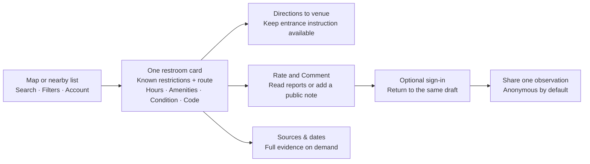

# Restroom Ready — journey and information architecture review

Reviewed November 5, 2026. Recommendations only; no product, database, release or Git changes.

Input version: `514b81875a8f88064eb41848aa1131c2f1a39b18ed9a1ada45cab5443038551f`. [Exact input hashes](inputs.json) bind the current worktree, three course persona definitions and the inspected November 5 captures. HEAD alone does not identify these largely uncommitted sources. This is a source-based heuristic review with persona simulations, not customer interviews, a usability study or a new functional acceptance run.

## Assessment

The native app has the right basic shape: map and inline search, optional filters, a half-height card that can expand, and one prominent Directions action. The next improvement should shorten the path from a pin to a usable choice. It should not add onboarding, more navigation destinations or more permanent main-screen controls.

The main remaining mismatch is between the user's decision and the information architecture. The user asks “Can I enter and reach this restroom?” The native app answers that partly with amenity labels, then stores the actual restrictions and entrance instructions in **Sources & dates → Reported details**. The web app exposes those facts directly but surrounds them with much more text, and still has two separate visit-contribution forms.

The existing Maya, Chloe and Alex definitions are fictional composites grounded in supplied research. Alex represents situational access while carrying luggage; he is explicitly not a wheelchair-user proxy. The wheelchair journey below is a heuristic task derived from the product's route requirements, not a new interview finding.

## What the evidence supports

- The [brand position](../../brand_position.md) calls for entry permission, physical route and dated conditions to answer different questions; business hours do not establish restroom hours.
- The style guide and current native code support map-first browsing, short neutral controls, no branded page header, compact filters without descriptions, and optional contributions.
- The current normal-size native capture shows Hours, Amenities, Condition, Passcodes, an optional Visitor reports summary, Rate and Comment, Sources & dates and Directions. Its Condition value is **Listed Operational** with **Date not shown**. Operational status is useful evidence, but does not describe usable supplies or cleanliness.
- The current 320-pixel web capture shows a provenance paragraph before Hours, then an expanded schedule containing both “Listed restroom hours: Hours unknown” and a known venue schedule. This is accurate about scope but slow to scan.
- The November 5 native hours checks cover normal and largest accessibility text, sheet expansion, full-week reachability and the fixed Directions footer. They do not prove all forms, real sign-in, physical-device behavior or real users' understanding.
- Current native `Place.subtitle` already shows an address when available. The screenshot fixture falls back to “Library”; there is no evidence of a universal missing-address bug.
- Current Hours presentation already distinguishes **Venue hours** from restroom hours. Keep that distinction; do not describe this as an unfixed silent business-hours substitution.

Inspected captures: [native card](../../features/screenshots/native-hours-today-normal.png), [largest-text expanded hours](../../features/screenshots/native-hours-week-large-text-start.png), [live web at 320 px](../../features/screenshots/web-hours-live-expanded-320.png). Earlier TestFlight screenshots were not used as current defect evidence.

## Priority recommendations

### P1 — put known dealbreakers in the decision card

**Evidence:** `PlaceDetailSheet.swift:243` builds Sources & dates; its Reported details disclosure at line 255 contains the entry and route functions at lines 890 and 914. Amenities at line 448 shows short positive labels. Important facts can therefore require opening a destination named for provenance, then another disclosure.

**Change:** Keep the unified **Accessible** label. Surface a known restriction and the specific usable entrance/route before Directions: for example, a short “Customers only · Purchase required” line when reported, plus a concise entrance instruction when one exists. Put route details in an immediately discoverable disclosure on the existing card, not exclusively in the source archive. This can reuse existing fields and views; it does not need another top-level page or a new certification label.

**Constraint:** “Accessible,” “Stair Free,” elevator-to-restroom, automatic doors and stall features remain different claims. Do not turn an elevator somewhere in a building into an elevator route to the restroom. Missing facts stay unknown. An external walking-directions link is not a promise of a wheelchair-suitable street route.

**Acceptance:** Starting from a filtered pin, a user can identify the reported entrance, floor, required stairs/elevator and known purchase restriction before leaving for Maps. Full source details remain reachable but are not required to discover the instruction.

### P1 — stop operational status from answering a condition question

**Evidence:** The current native capture places “Listed Operational” in Condition. `CardResearchProfile.swift:76` falls back to publishedStatus when no stronger condition fact exists.

**Change:** Keep Condition for actual reported usability/condition. When only operating status exists, show “Condition not reported” and identify the status separately as a dated listing status. A reported closure should remain a conspicuous dated warning. Avoid adding an always-empty status row; display it only when useful.

**Acceptance:** A person looking for paper, soap or a usable restroom never reads “Operational” as a clean/stocked report. Condition, rating average and closure status remain separate.

### P1 — give both platforms one post-visit contribution path

**Evidence:** Native `publicNoteCard` at `PlaceDetailSheet.swift:1394` opens the unified `PublicVisitForm`. Web `explorer.tsx:527` still supplies both `VisitReports` and `PublicNotes`; their active actions are “Share a visit” and “Add a visit note.” They overlap in visit time, condition, supplies and stairs. Native `ContributionForms.swift:147` is unified, but it still exposes several entry and observation pickers, many with separate navigation pages.

**Change:** Keep **Rate and Comment** as the one destination. It contains the rating editor and one **Add a public note** action. The first contribution surface needs visit time, anonymous attribution, optional note and a quick condition choice. Put the remaining optional entry, route and supply observations behind compact groups. Preserve all legacy reads while retiring duplicate creation UI. A new public note must not also require a star rating.

**Constraint:** The optional code keeps its own Only me/Everyone setting and separate code record. Anonymous controls attribution, not whether the note is public. Keep the current default of anonymous attribution and private code visibility.

**Acceptance:** People can share one useful observation without completing unrelated fields or deciding which report type to create. An error preserves the same draft, and returning from sign-in restores the intended form without publishing automatically.

### P1 — make filter outcomes understandable and consistent

**Evidence:** Native uses independent Clean, Accessible, Stair Free, Public and Elevator access selections with AND. Web `lib/restroom-filters.ts:5` and `explorer.tsx:464` use a single selected option including ALL and No code; no Elevator access option is exposed. Native's bottom control can collapse several constraints into “Filters (n),” and successful empty search feedback is only “No restroom was found” (`NativeRootView.swift:292`).

**Change:** Align the web's filter choices and combination behavior with the intended native contract. Keep the native filter sheet description-free. Show selected constraints compactly in results context, and give an empty filtered result a direct **Clear filters** action. Loading/failed evidence stays distinct from a true no-match state. Do not silently drop a selected filter to produce results.

**Constraint:** Clean is an average threshold, not a live condition; Public is reported/directory access, not necessarily purchase-free. No code cannot mean “no shared code was found.”

**Acceptance:** The same place and same supported constraints produce the same inclusion decision across platforms. Users can recover from a too-restrictive combination without hunting through Account or restarting search.

### P2 — simplify the public/private passcode mental model

**Evidence:** Native `PlaceDetailSheet.swift:653` prioritizes a public code ahead of an owned private code in the main summary. Details correctly preserve ownership, Reported and Last verified dates, Worked/Didn’t work counts and separate alternatives. At line 1010 the presentation explains a four-confirmation history-hiding algorithm; the web repeats it at `passcodes.tsx:189`.

**Change:** Use “Last reported worked” for a successful-use date, rather than a generic “Verified” badge. Keep the main preferred code, an obvious **Other reported codes** disclosure and an indicator when the account also has a private code. Put the full ordering/consensus explanation behind “Why this code first?” instead of making everyone learn the algorithm. Keep Only me visually distinct from Everyone in both reading and editing.

**Preserve:** Four distinct nonowner confirmations, failed-use counts, exact-version checks, independent reports, owner-only visibility controls, and private-default reporting. This is a presentation recommendation, not a request to alter consensus policy.

### P2 — reduce repeated evidence prose on mobile web

**Evidence:** `detail.tsx:107` begins with source notices, then Hours, Entry, Route inside, Amenities, Conditions, Passcodes and Rate and Comment. Several sections repeat that reports do not confirm present availability. The inspected 320-pixel screen has a long provenance block and unknown optional fields before the complete schedule.

**Change:** Use a compact decision summary with one short dated-source line. Keep the critical per-fact distinctions visible: venue versus restroom hours, unknown route, known restriction, and observation date. Move repeated technical explanations and optional empty metadata into **Sources & dates**, matching the native destination name. Do not remove unfavorable facts, unknowns that affect access, or actual sources to achieve brevity.

### P2 — make saving and returning predictable

**Evidence:** Native has an explicit pending Save continuation (`PlaceDetailSheet.swift:823`) and Account → Saved places. Web's signed-out `toggleFavorite` (`explorer.tsx:399`) signs in and returns before saving, so the original Save action needs another tap.

**Change:** Preserve the selected restroom and explicitly complete the requested Save after sign-in, or clearly present a single confirmation on return. Announce “Saved” in context with an optional way to open Saved places. A private code's automatic save should be explained at the success moment. Keep the existing Return to main map behavior and camera continuity.

**Later:** If map panning becomes a common fallback when location is unavailable, evaluate **Search this area**. Current native results sort by GPS distance when available and otherwise by name; they are not filtered to the visible map region. This is a potential next feature, not a current missing-location bug claim.

### P2 — make privacy and deletion copy match today's tasks

**Evidence:** Native Account already has Saved places and Comments by you only when signed in, compact signed-out content, red destructive actions and a privacy footer. The delete confirmation (`NativeAccountView.swift:33`) distinguishes retained restrooms/ratings from removed visit notes. The linked privacy page still leads with “Your email. A clear purpose.” and waitlist handling, and names an older “Report visit details” form (`app/privacy/page.tsx:3`).

**Change:** Lead the policy with current accounts, public notes, private codes, location and account deletion; put retained legacy waitlist handling later. At Delete account, summarize removed private data/owned public content and retained anonymous restroom/rating contributions in short, readable groups, with the full policy linked. Say that free text may identify its author even when posted anonymously. Name the actual Add a public note form.

**Do not infer:** This review did not execute account deletion or audit its backend. It evaluates the displayed explanation, not deletion correctness. Do not silently merge Apple and Google accounts by matching email; any future linking/sync work needs explicit provider verification.

## Minimal ideal screen flow

Keep the map, inline search suggestions, list switch, Locate me and compact add-restroom +. Keep every card opening at half height with an available full-height detent; do not force another search page or restore a branded app header. Use the same place context when moving among card, codes, reports and source details. Add a new restroom only when it is actually missing; contributing to an existing place should start from that card.

## Validation to do with people

The three accompanying persona verdicts are separate simulated passes over this same input version; they are not three customer sessions. The next real study should use task completion rather than asking whether the app looks good:

1. Find a plausible restroom nearby, identify an entry restriction and choose a fallback.
2. With Accessible and Stair Free selected, explain the difference between a reported label and the actual entrance/inside route. Include a participant who uses a wheelchair; Alex's luggage needs do not validate this workflow.
3. After a visit, publish one condition observation with a public note but no rating, then add a private code and explain what is public.
4. Save while signed out, finish sign-in, reopen Saved places and return to the original map.
5. Explain what account deletion retains and removes without reading the entire policy.

Record completion, wrong interpretations, backtracks, abandoned fields and recovery after a controlled error. Do not invent success rates or set a contribution-time target from the existing interviews. Repeat at normal and large text sizes, with location denied, an empty filter result and a failed additional-details feed.

## Review limits and disposition

This review inspected current local source and version-matched November 5 hours evidence. It did not run the current TestFlight build, a fresh live sign-in, keyboard/VoiceOver, deletion, contribution submission or the full web workflow. Form and account findings are code-based; only the linked captures support direct visual claims. The largest-text image is an accessibility-size case, not evidence that normal text is globally too large.

No previous persona verdict was treated as research evidence. No extra features, paid-user claims, restroom facts or claimed new users were invented. All recommendations remain unimplemented pending product choice and validation.
